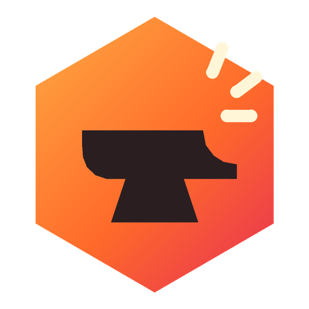
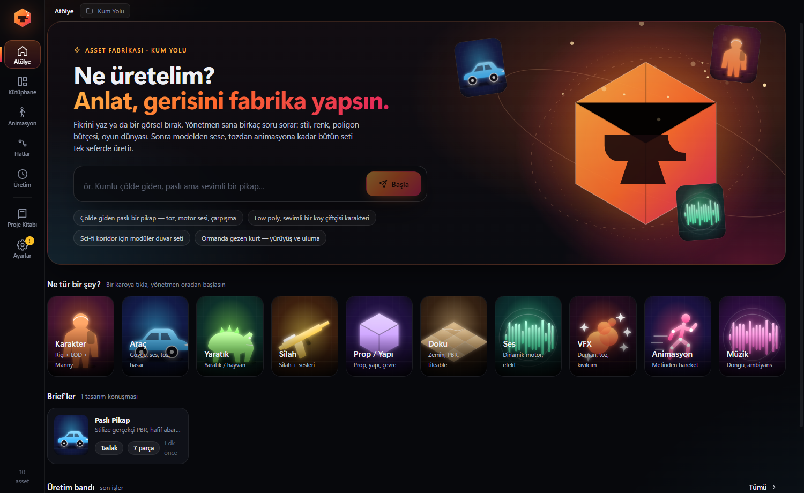
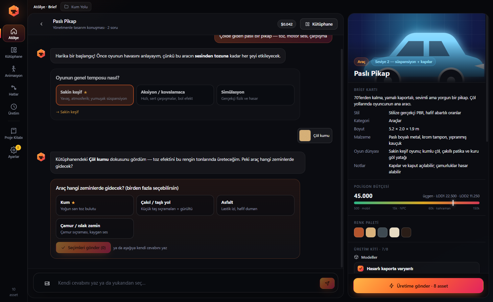
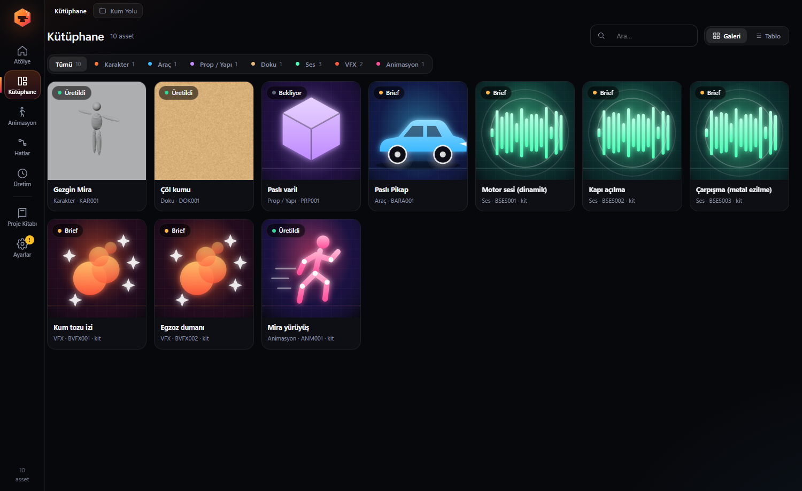
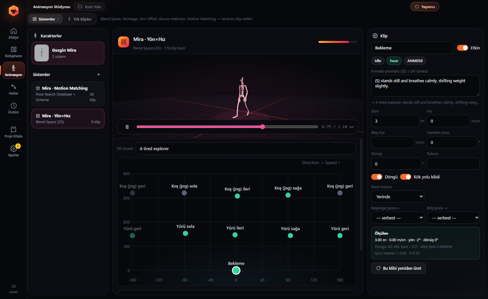
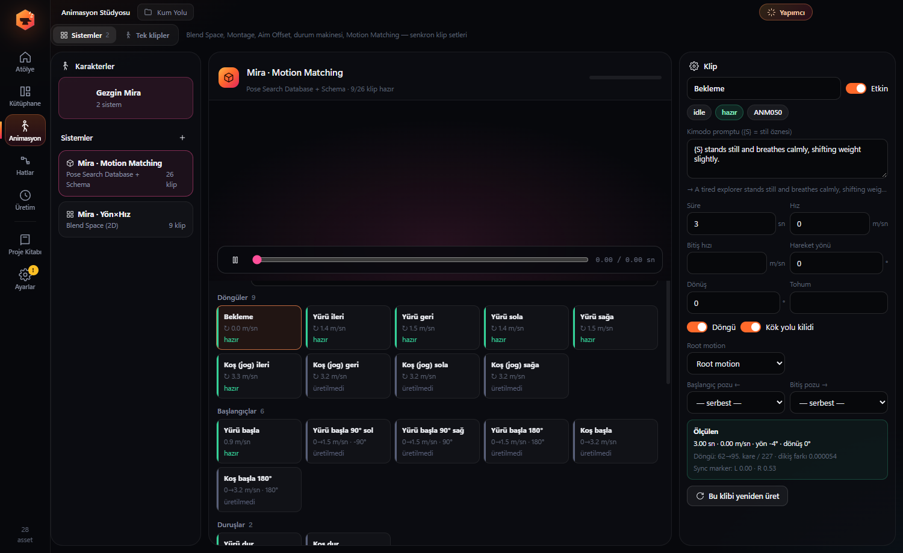

<div align="center">



# AssetForge — Pipeline de assets para videojuegos con IA para Unreal Engine 5

**Descríbelo una vez. Obtén modelos, texturas, sonidos, VFX y sistemas de animación sincronizados, listos para el juego e importados directamente en Unreal Engine.**

[](https://github.com/HErkanuzun/AssetForge/releases/latest)

[](LICENSE)


[English](README.md) · [Türkçe](README.tr.md) · **Español** · [简体中文](README.zh-CN.md)



</div>

---

## ¿Qué es AssetForge?

AssetForge es una **aplicación de escritorio para Windows que convierte una breve descripción de texto en assets listos para producción en Unreal Engine 5**. Es gratuita y de código abierto. Encadena servicios de IA en un único pipeline basado en nodos:

| Paso | Servicio | Resultado |
|---|---|---|
| Motor de prompts, dirección de arte, control de calidad visual | Claude, o cualquier LLM compatible con OpenAI o local (Ollama, LM Studio, vLLM, OpenRouter) | Prompts específicos para cada servicio que respetan la biblia de estilo del proyecto |
| Texto/imagen a 3D, retexturizado, rigging | Meshy | Mallas GLB/FBX, texturas PBR, rigs compatibles con UE5 Manny |
| Texto a movimiento | NVIDIA Kimodo (local, CUDA) | Clips de animación en bucle con root motion |
| Efectos de sonido y audio dinámico de motor | ElevenLabs | SFX y capas de RPM conectadas a un MetaSound |
| Texturas e imágenes conceptuales | ComfyUI (local, cualquier workflow) | Texturas PBR repetibles y sprites |
| Limpieza y LOD | Blender (sin interfaz) | FBX escalado, reducido y renombrado con LOD 50/25/10 % |
| Importación | Python Remote Execution de Unreal Engine 5 | Assets en las carpetas correctas, instancias de material, Blend Spaces, Montages y bases de datos de Pose Search |

Está pensada para desarrolladores indie, artistas técnicos y estudiantes que quieren **assets coherentes y específicos de su proyecto** en lugar de generaciones sueltas.

## Características

- **Chat de briefing con un director de IA.** Escribe "una camioneta oxidada cruzando el desierto". El director hace preguntas con opciones (ritmo, terreno, estilo, paleta, presupuesto de polígonos) y arma un **kit de producción**: el modelo, el sonido del motor, sonidos de puertas e impactos, VFX de polvo, variantes de daño y animaciones. Un clic lo envía todo a la cola.
- **Sistemas de animación, no solo clips.** Genera conjuntos de clips sincronizados y los monta automáticamente en Unreal:
  - Secuencia simple y **Anim Montage** (acciones que empiezan y terminan en la pose de reposo)
  - **Blend Space 1D** (velocidad) y **Blend Space 2D** (dirección × velocidad) con velocidades medidas
  - **Máquina de estados de salto** (inicio → bucle → aterrizaje con poses coincidentes)
  - **Aim Offset** (poses aditivas en espacio de malla)
  - **Motion Matching** con un conjunto de 26 clips, un Pose Search Schema (trayectoria + pies/pelvis) y una Pose Search Database rellenada automáticamente
- **Bucles sin costuras.** Los bucles se cortan de apoyo a apoyo del pie izquierdo usando los contactos de Kimodo. El error de la costura se reparte por el clip (0,00° medido en Unreal). Se miden la velocidad, la dirección y el giro reales, y se añaden marcadores de sincronización L/R.
- **Transiciones con poses coincidentes.** Los clips de inicio, parada, giro y pivote fijan su primer y último fotograma a la pose del clip vecino, con una trayectoria de raíz fotograma a fotograma.
- **Biblia del proyecto.** Dirección de arte, paleta, biblioteca de materiales, reglas por categoría y presupuestos técnicos. Puede rellenarse automáticamente desde los PDF de tu GDD.
- **Bucle de control de calidad.** Comprobaciones técnicas (triángulos, UV, tamaño) y revisión visual con IA. Si la puntuación es baja, se reescribe el prompt y se repite el pipeline.
- **Editor de pipelines por nodos** (React Flow) con plantillas para personajes, vehículos, props, texturas, sonidos, VFX y animación.
- **Importación desde hojas de cálculo.** Importa tu lista de assets desde Excel o CSV.
- **Agente de IA "Productor" (Ctrl+J).** Asistente integrado con más de 20 herramientas: crear assets, ejecutar pipelines, revisar vistas previas, generar animaciones y ejecutar Python en Unreal. Las acciones de pago o irreversibles siempre piden confirmación.
- **Servidor y cliente MCP.** AssetForge expone un servidor [Model Context Protocol](https://modelcontextprotocol.io) protegido por token en `http://127.0.0.1:9560/mcp`, para que Claude Code, Claude Desktop o cualquier cliente MCP controlen tu pipeline. También puedes conectar servidores MCP externos (Blender MCP, Unreal MCP, sistema de archivos…).
- **Usa tu propio modelo.** Asigna LLM distintos al asistente, al motor de prompts y al control de calidad visual.
- **Personajes listos para el juego.** Nombres de huesos de UE5 Manny/Quinn, LOD, IK Rig y retargeter, esqueleto SOMA compartido con retargeting automático.

## Capturas de pantalla

| Chat de briefing con el director de IA | Biblioteca de assets |
|---|---|
|  |  |
| **Blend Space 2D con velocidades medidas** | **Conjunto de clips para Motion Matching** |
|  |  |

## Descarga e instalación

1. Descarga **`AssetForge-Setup-x.y.z.exe`** desde la [última versión](https://github.com/HErkanuzun/AssetForge/releases/latest).
2. Ejecuta el instalador. Aún no está firmado, así que Windows SmartScreen puede avisarte: haz clic en **Más información → Ejecutar de todas formas**.
3. Abre **Ajustes (Ayarlar)** y añade las claves de API que vayas a usar. Se guardan cifradas con Windows DPAPI en tu equipo.
4. Elige una carpeta de proyecto y empieza en el **Taller (Atölye)**.

> La interfaz está actualmente en **turco**. La traducción al inglés está prevista para la versión 0.6 (ver [ROADMAP.md](ROADMAP.md)).

### Requisitos

| Componente | Para qué | Notas |
|---|---|---|
| Windows 10/11 x64 | la aplicación | |
| Unreal Engine 5.x | importación y montaje | Activa *Python Editor Script Plugin* y *Project Settings → Python → Enable Remote Execution*. Probado en UE 5.8. |
| Blender 4.x / 5.x | limpieza, LOD, FBX | Se detecta automáticamente. Probado en Blender 5.2. |
| Clave de Anthropic **o** endpoint compatible con OpenAI | prompts, briefing, QA, agente | También funcionan modelos locales con Ollama o LM Studio. |
| Clave de Meshy | modelos 3D, texturas, rigging | |
| Clave de ElevenLabs | efectos de sonido, audio de motor | |
| ComfyUI (opcional) | texturas e imágenes locales | Cualquier workflow en formato API con `{{PROMPT}}` |
| GPU NVIDIA + ~25 GB de disco (opcional) | texto a movimiento con Kimodo | Instalación con un clic desde la página de Animación. Requiere un token de Hugging Face. |

## Compilar desde el código fuente

```bash
git clone https://github.com/HErkanuzun/AssetForge.git
cd AssetForge
npm install
npm run dev     # desarrollo
npm run dist    # instalador de Windows en dist/
npm run check   # tipos, lint, formato y pruebas (igual que CI)
```

## Versiones y hoja de ruta

El proyecto usa [Versionado Semántico](https://semver.org/lang/es/). Versión actual: **0.5.0 (alpha)**. Tiempo estimado hasta la 1.0: unos 6 meses. Detalles en [ROADMAP.md](ROADMAP.md) y cambios en [CHANGELOG.md](CHANGELOG.md).

## Contribuir

Se agradecen reportes de errores, ideas, traducciones y pull requests (en inglés o turco). Empieza por [CONTRIBUTING.md](CONTRIBUTING.md). Respeta el [Código de conducta](CODE_OF_CONDUCT.md) e informa de problemas de seguridad en privado como se indica en [SECURITY.md](SECURITY.md).

## Licencia

AssetForge es **software libre y de código abierto** bajo la [GNU Affero General Public License v3.0](LICENSE) (AGPL-3.0-only). El texto vinculante es el archivo de licencia en inglés; este resumen es solo informativo.

- ✅ Gratis para todos: particulares, estudios, escuelas y empresas, incluidos proyectos de juegos comerciales
- ✅ Los assets que generes no están cubiertos por la AGPL. Lo que puedes hacer con ellos depende de los servicios y modelos de IA que los crearon (ver [THIRD_PARTY_NOTICES.md](THIRD_PARTY_NOTICES.md))
- ✅ Puedes modificarlo y compartir tus cambios, siempre que compartas su código fuente bajo la AGPL
- ⚠️ Si ofreces una versión modificada a otros a través de una red, debes ofrecerles su código fuente (sección 13 de la AGPL)

**Licencia comercial:** para usar el código de AssetForge en un producto o servicio de código cerrado, o con condiciones distintas de la AGPL, consulta [COMMERCIAL.md](COMMERCIAL.md). Las contribuciones se aceptan bajo el [CLA](CLA.md); ver [CONTRIBUTING.md](CONTRIBUTING.md).

Las versiones hasta la 0.4.2 se publicaron bajo la PolyForm Noncommercial License 1.0.0. Desde la 0.4.3, AssetForge es AGPL-3.0.

Copyright © 2026 Hasan Erkan Uzun. Unreal Engine, Meshy, ElevenLabs, ComfyUI, Blender, Claude y NVIDIA Kimodo son marcas de sus respectivos propietarios. AssetForge no está afiliado a ellos. Cada servicio está sujeto a sus propios términos.
