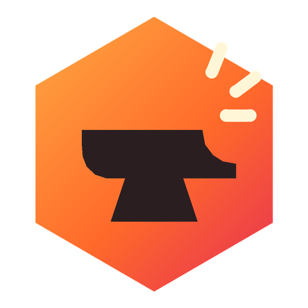
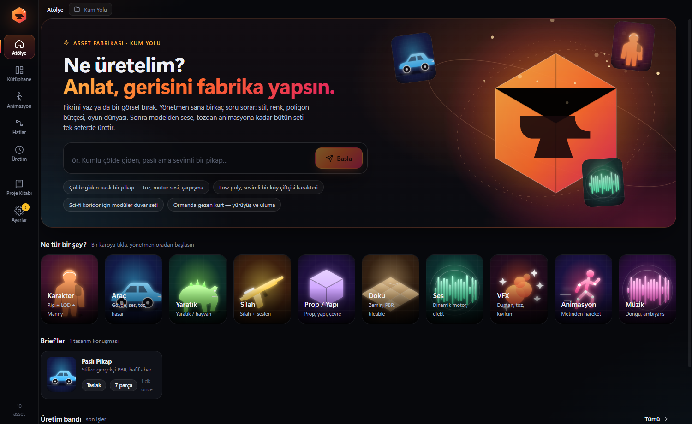
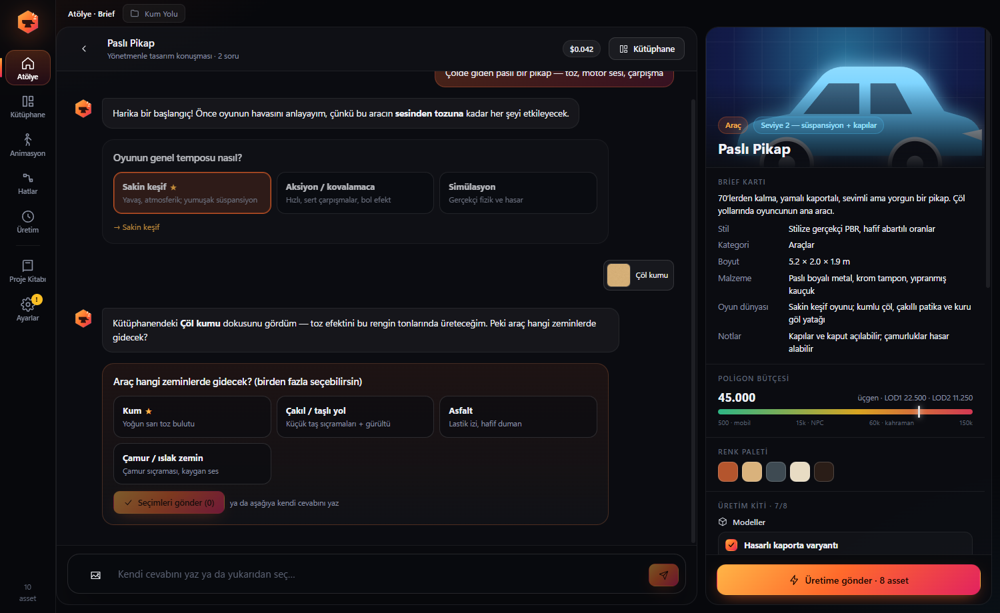
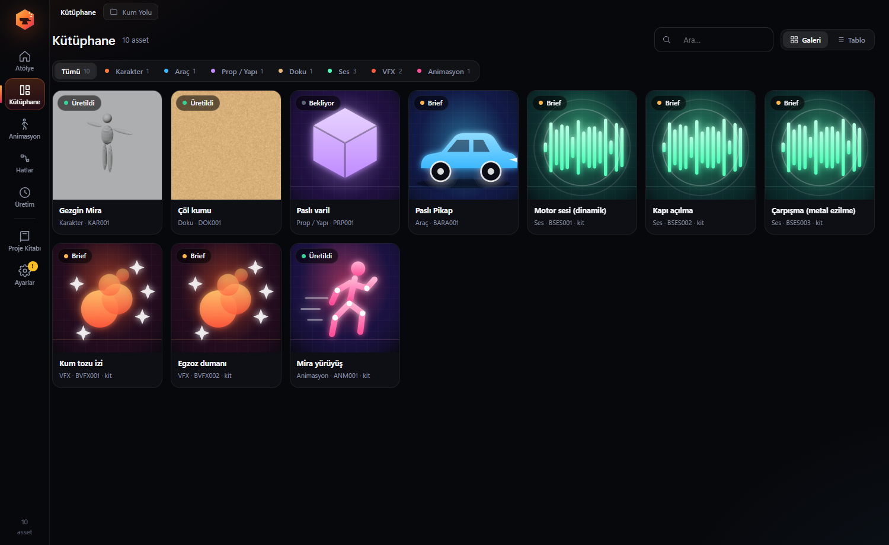
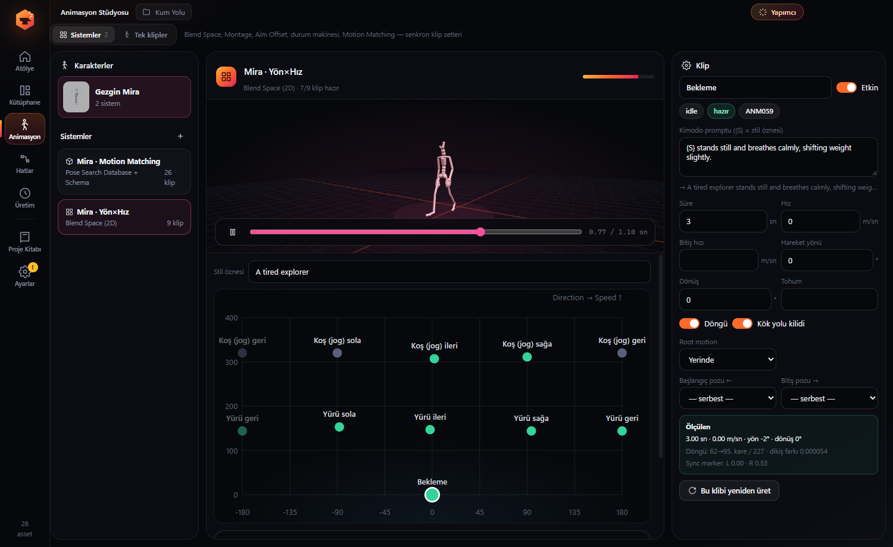
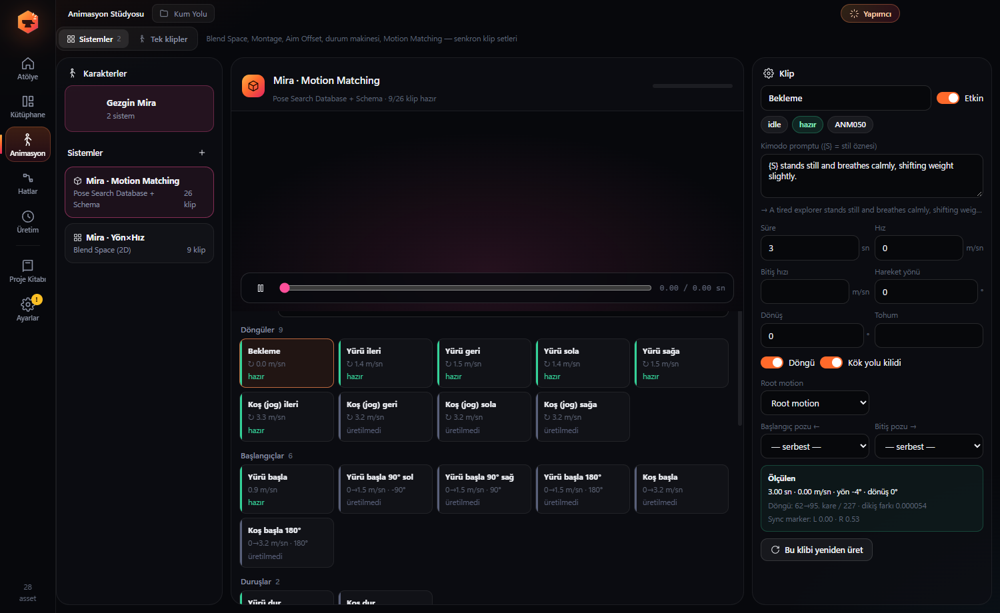

<div align="center">



# AssetForge — Unreal Engine 5 için Yapay Zekâ Oyun Asset Üretim Hattı

**Bir kez anlat; oyuna hazır model, doku, ses, VFX ve senkron animasyon sistemleri doğrudan Unreal Engine'e gelsin.**

[](https://github.com/HErkanuzun/AssetForge/releases/latest)

[](LICENSE)


[English](README.md) · **Türkçe** · [Español](README.es.md) · [简体中文](README.zh-CN.md)



</div>

---

## AssetForge nedir?

AssetForge, **kısa bir metin tarifini Unreal Engine 5 için üretime hazır oyun asset'lerine dönüştüren** ücretsiz ve açık kaynaklı bir Windows masaüstü uygulamasıdır. Yapay zekâ servislerini tek bir node tabanlı hatta birleştirir:

| Adım | Servis | Çıktı |
|---|---|---|
| Prompt motoru, sanat yönetimi, görsel kalite kontrol | Claude ya da OpenAI uyumlu / yerel her LLM (Ollama, LM Studio, vLLM, OpenRouter) | Proje Kitabı'na uygun, servise özel promptlar |
| Metin/görselden 3D, yeniden dokulama, rig | Meshy | GLB/FBX modeller, PBR dokular, UE5 Manny uyumlu rig |
| Metinden hareket | NVIDIA Kimodo (yerel, CUDA) | Döngülü, root motion'lı animasyon klipleri |
| Ses efektleri ve dinamik motor sesi | ElevenLabs | SFX ve MetaSound'a bağlı RPM katmanları |
| Görsel, doku, 3D, ses ve hareket | ComfyUI (her workflow: TRELLIS.2, ACE-Step gibi ücretsiz yerel modeller ya da Comfy hesabıyla Meshy, Tripo, Rodin, ElevenLabs gibi partner düğümleri) | Dokular, sprite'lar, görselden 3D model, müzik, hareket klipleri |
| Temizlik ve LOD | Blender (arka planda) | Ölçeklenmiş, sadeleştirilmiş, isimlendirilmiş FBX + LOD %50/25/10 |
| İçe aktarma | Unreal Engine 5 Python Remote Execution | Doğru klasörlere asset, materyal örnekleri, Blend Space, Montage, Pose Search veritabanı |

Tek seferlik üretimler yerine **tutarlı, projeye özel asset** isteyen bağımsız geliştiriciler, teknik sanatçılar ve öğrenciler için tasarlandı.

## Özellikler

- **Yönetmen tarzı Brief sohbeti.** "Çölde giden paslı bir pikap" yaz. Yapay zekâ yönetmen tıklanabilir sorular sorar (tempo, zemin, stil, palet, poligon bütçesi) ve bir **üretim kiti** hazırlar: model, motor sesi, kapı ve çarpışma sesleri, toz VFX'i, hasar varyantları ve animasyonlar. Tek tıkla hepsi kuyruğa girer.
- **Klip değil, animasyon sistemi.** Birbirini tamamlayan, senkron klip setlerini üretir ve Unreal'da otomatik kurar:
  - Tek Klip (Sequence) ve **Aksiyon Montajı** (bekleme pozundan başlayıp ona dönen hareketler)
  - **Blend Space 1D** (hız) ve **Blend Space 2D** (yön × hız), örnekler ölçülen gerçek hızlarda
  - **Zıplama durum makinesi** (başla → döngü → in, pozlar eşli)
  - **Nişan Ofseti (Aim Offset)**, mesh-space additive pozlarla
  - **Motion Matching**: 26 kliplik dans kartı, Pose Search Schema (trajektori + ayak/kalça) ve otomatik doldurulan Pose Search Database
- **Dikişsiz döngüler.** Döngü, Kimodo'nun ayak temaslarından sol ayak basışından sol ayak basışına kesilir. Dikiş farkı klibe yayılır (Unreal'da ölçülen hata 0.00°). Gerçek hız, yön ve dönüş ölçülür; Blend Space senkronu için L/R sync marker'lar eklenir.
- **Poz eşli geçişler.** Başlangıç, duruş, dönüş ve pivot kliplerinin ilk/son kareleri komşu klibin pozuna kilitlenir; kök yolu kare kare verilir.
- **Proje Kitabı.** Sanat yönü, palet, malzeme kütüphanesi, kategori kuralları ve teknik bütçeler. GDD veya evren el kitabı PDF'lerinden otomatik doldurulabilir.
- **Kalite kontrol döngüsü.** Teknik ölçüm (üçgen, UV, boyut), yapay zekâ ile görsel inceleme, animasyonda yerel ölçüm (ayak kayması, zemine girme, titreme, hız ve yön) ve seste yerel ölçüm (sessizlik, kırpılma, seviye, döngü dikişi). Puan düşükse prompt yeniden yazılır, hat tekrar çalışır; animasyon yeni bir tohumla yeniden üretilir.
- **Node tabanlı hat editörü** (React Flow) ve karakter, araç, prop, doku, ses, VFX ve animasyon için hazır hatlar.
- **Tablo içe aktarma.** Asset listeni Excel/CSV'den al; Palet ve Malzemeler sayfaları doğrudan Proje Kitabı'na gider.
- **Yapımcı asistanı (Ctrl+J).** 20'den fazla araçla uygulama içi asistan: asset yazma, hat çalıştırma, önizlemeleri inceleme, animasyon üretme, Unreal'da Python çalıştırma. Para harcayan veya geri alınamayan işlemler her zaman onay ister.
- **MCP sunucusu ve istemcisi.** AssetForge `http://127.0.0.1:9560/mcp` adresinde token korumalı bir [Model Context Protocol](https://modelcontextprotocol.io) sunucusu açar. Claude Code, Claude Desktop veya herhangi bir MCP istemcisi hattını yönetebilir. Dış MCP sunucuları (Blender MCP, Unreal MCP, dosya sistemi…) araç olarak eklenebilir.
- **Kendi modelini bağla.** Asistan, prompt motoru ve görsel kalite kontrol için ayrı LLM'ler atanabilir.
- **Oyuna hazır karakterler.** UE5 Manny/Quinn kemik adları, LOD'lar, IK Rig ve retargeter, ortak SOMA iskeleti ve otomatik retarget.

## Ekran görüntüleri

| Yapay zekâ yönetmenle Brief | Kütüphane |
|---|---|
|  |  |
| **Ölçülen hızlarla Blend Space 2D** | **Motion Matching dans kartı** |
|  |  |

## İndirme ve kurulum

1. [Son sürümden](https://github.com/HErkanuzun/AssetForge/releases/latest) **`AssetForge-Setup-x.y.z.exe`** dosyasını indir.
2. Kurulumu çalıştır. Kurulum dosyası henüz imzalı değil; Windows SmartScreen uyarırsa **Ek bilgi → Yine de çalıştır**'a tıkla.
3. **Ayarlar**'dan kullanacağın API anahtarlarını gir. Anahtarlar bu bilgisayarda Windows şifrelemesiyle (DPAPI) saklanır.
4. Proje klasörünü seç ve **Atölye**'de ("Ne üretelim?") başla.

### Gereksinimler

| Bileşen | Ne için | Not |
|---|---|---|
| Windows 10/11 x64 | uygulama | |
| Unreal Engine 5.x | içe aktarma ve kurulum | *Python Editor Script Plugin* ve *Project Settings → Python → Enable Remote Execution* açık olmalı. UE 5.8'de test edildi. |
| Blender 4.x / 5.x | temizlik, LOD, FBX | Otomatik bulunur. Blender 5.2'de test edildi. |
| Anthropic API anahtarı **veya** OpenAI uyumlu uç | prompt, Brief, kalite kontrol, asistan | Ollama veya LM Studio ile yerel modeller de çalışır. |
| Meshy API anahtarı | 3D model, doku, rig | |
| ElevenLabs API anahtarı | ses efektleri, motor sesi | |
| ComfyUI (isteğe bağlı) | görsel, 3D, ses, hareket | API formatında her workflow. Düğüm başlıklarını `AF:prompt`, `AF:image`, `AF:model`, `AF:audio`, `AF:seed` yap (ya da `{{PROMPT}}` yer tutucuları). Comfy hesabı anahtarı yalnızca partner düğümleri için gerekir. |
| NVIDIA GPU + ~25 GB disk (isteğe bağlı) | Kimodo metinden hareket | Animasyon sayfasından tek tıkla kurulum. Hugging Face token gerekir. |

### İlk kurulum adımları

1. **Ayarlar** → API anahtarları ve proje klasörü.
2. **Asset Listesi** → Excel/CSV içe aktar (ör. `Oyun_Asset_Listesi.xlsx`).
3. **Proje Kitabı** → "PDF'lerden doldur" ile GDD'ni seç, kategori kurallarını gözden geçir.
4. Asset seç → hat seç → **Üret**. İlerlemeyi **Üretim**'de izle.
5. (Animasyon) **Ayarlar → Animasyon** → Hugging Face token (önce huggingface.co'da `meta-llama/Meta-Llama-3-8B-Instruct` lisansını kabul et). **Animasyon** sayfasında Kimodo adımlarını sırayla "Kur" ile çalıştır, sonra "Başlat".

**Kimodo arka uçları:** Yerel Windows (varsayılan, `resources/kimodo/setup_native.ps1`, BIOS sanallaştırması gerekmez) veya WSL2 + Docker (`resources/kimodo/setup_wsl.sh`, BIOS'ta SVM/VT-x açık olmalı). Modeller varsayılan olarak uygulama veri klasörüne kurulur; Ayarlar → Animasyon'dan büyük bir diske taşınabilir.

**Unreal otomatik import:** Editör kapalıysa export klasöründeki `ue_import_*.py` dosyası *File → Execute Python Script* ile elle çalıştırılabilir.

**ComfyUI:** Hatlarda *ComfyUI İş Akışı* düğümü her workflow'u çalıştırır ve çıktısını (görsel, 3D model, ses, BVH/FBX animasyon) sonraki adıma verir. Workflow'u ComfyUI'da *Workflow → Export (API)* ile kaydet. AssetForge'un değerleri başlığı `AF:prompt`, `AF:negative`, `AF:seed`, `AF:image`, `AF:model`, `AF:audio` olan düğümlere yazılır; başlık yoksa örnekleyicinin positive/negative metni ve tek yükleyici düğümü kendiliğinden bulunur. Eski `{{PROMPT}}`, `{{NEGATIVE}}`, `"{{SEED}}"` yer tutucuları da çalışır. Varsayılan workflow: `resources/comfyui/default_workflow_api.json` (SDXL).

## Kaynaktan derleme

```bash
git clone https://github.com/HErkanuzun/AssetForge.git
cd AssetForge
npm install
npm run dev     # geliştirme
npm run dist    # Windows kurulum dosyası (dist/), versions/ arşivine de kopyalanır
npm run versions -- --download  # versions/ klasörüne tüm sürümleri indir (kurulum, kaynak, notlar)
npm run check   # tip kontrolü, lint, biçim ve testler (CI ile aynı)
```

## Mimari

```
src/shared/      tipler, node tanımları, hazır hatlar, animasyon sistemi kataloğu
src/main/        Electron ana süreç
  providers/     claude, meshy, elevenlabs, comfyui, brief
  integrations/  blender, ue (Remote Execution), kimodo
  engine/        runner (sıralama, QA tekrar, kuyruk), executors (node çalıştırıcıları)
  anim/          animasyon sistemleri: kök yolu, üretim fazları, UE manifest
  agent/         Yapımcı asistanı, MCP sunucusu ve istemcisi
src/renderer/    React arayüz
resources/       python/ (Blender ve Unreal betikleri), kimodo/, comfyui/
```

Yeni bir yapay zekâ servisi eklemek için `src/shared/nodes.ts`'e node tanımı, `src/main/engine/executors.ts`'e çalıştırıcı ekle.

## Sürümler ve yol haritası

Proje [Semantik Sürümleme](https://semver.org/lang/tr/) kullanır. Şu anki sürüm **0.4.8 (alpha)**; 1.0 için tahmini süre yaklaşık 6 ay. Ayrıntılar: [ROADMAP.md](ROADMAP.md) · Değişiklikler: [CHANGELOG.md](CHANGELOG.md)

## Katkı

Hata bildirimleri, fikirler, çeviriler ve pull request'ler memnuniyetle karşılanır; İngilizce ya da Türkçe yazabilirsin. [CONTRIBUTING.md](CONTRIBUTING.md) ile başla. [Davranış kurallarına](CODE_OF_CONDUCT.md) uy, güvenlik açıklarını [SECURITY.md](SECURITY.md)'de anlatıldığı gibi gizli bildir.

## Lisans

AssetForge, [GNU Affero Genel Kamu Lisansı v3.0](LICENSE) (AGPL-3.0-only) ile **ücretsiz ve açık kaynaklıdır**. Bağlayıcı metin İngilizce lisans dosyasıdır; aşağıdaki özet bilgi içindir.

- ✅ Herkes için ücretsiz: bireyler, stüdyolar, okullar ve şirketler; ticari oyun projeleri dahil
- ✅ Ürettiğin asset'ler AGPL kapsamında değildir. Onlarla ne yapabileceğin, onları üreten yapay zekâ servislerinin ve modellerin koşullarına bağlıdır ([THIRD_PARTY_NOTICES.md](THIRD_PARTY_NOTICES.md))
- ✅ Değiştirip paylaşabilirsin; değişikliklerinin kaynak kodunu da AGPL ile paylaşman şartıyla
- ⚠️ Değiştirilmiş bir sürümü başkalarına ağ üzerinden hizmet olarak sunarsan, kaynak kodunu onlara da sunman gerekir (AGPL madde 13)

**Ticari lisans:** AssetForge kodunu kapalı kaynaklı bir ürün ya da hizmette veya AGPL dışı koşullarla kullanmak için [COMMERCIAL.md](COMMERCIAL.md). Katkılar [CLA](CLA.md) ile kabul edilir; bkz. [CONTRIBUTING.md](CONTRIBUTING.md).

0.4.2'ye kadarki sürümler PolyForm Noncommercial 1.0.0 lisansıyla yayınlandı. 0.4.3'ten itibaren AssetForge AGPL-3.0'dır.

Telif hakkı © 2026 Hasan Erkan Uzun. Unreal Engine, Meshy, ElevenLabs, ComfyUI, Blender, Claude ve NVIDIA Kimodo ilgili sahiplerinin markalarıdır; AssetForge bu şirketlerle bağlantılı değildir. Her servis kendi kullanım koşullarına tabidir.
