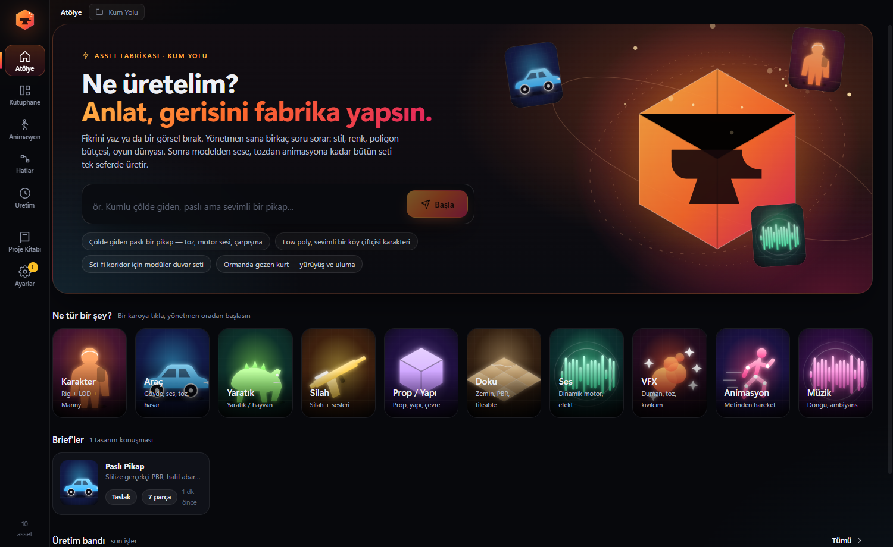
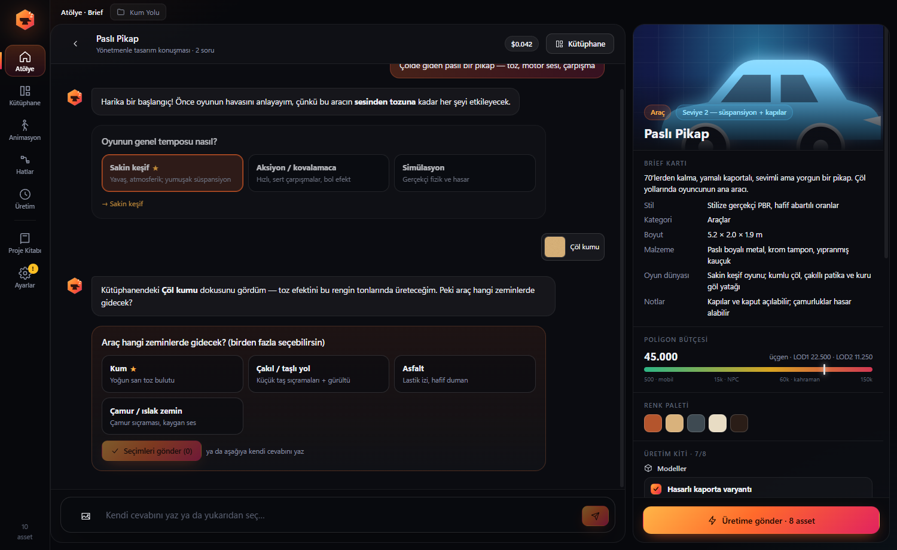
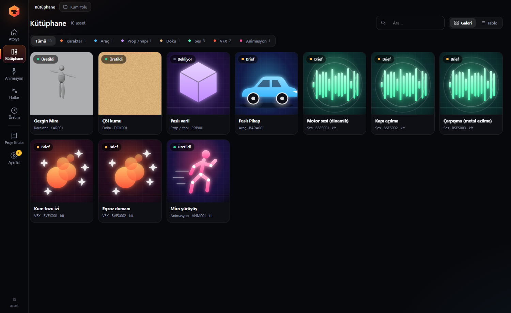
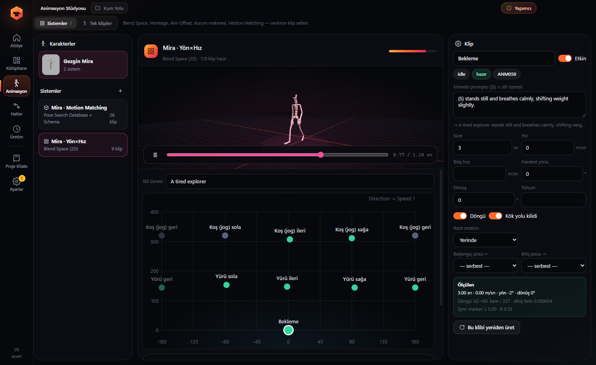
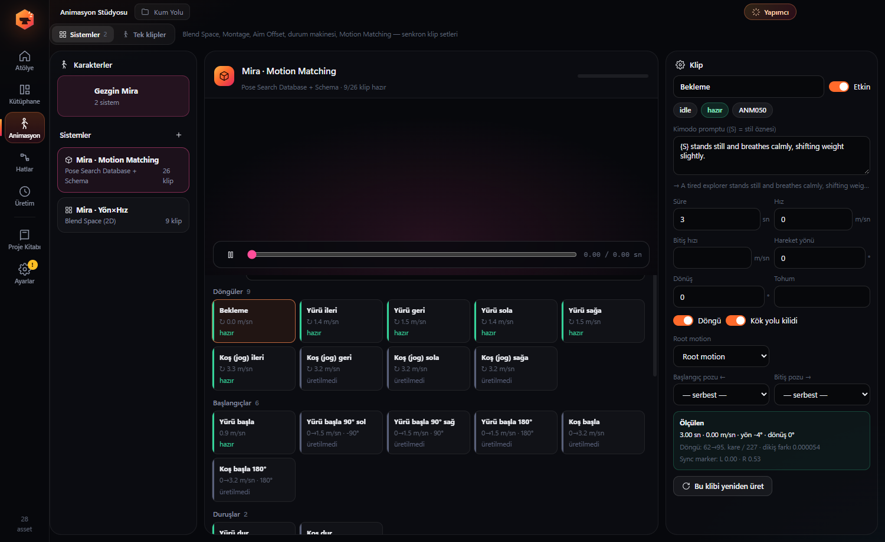

<div align="center">


# AssetForge — 面向虚幻引擎 5 的 AI 游戏资产生产管线

**只需描述一次，即可获得可直接用于游戏的模型、贴图、音效、VFX 和同步动画系统，并自动导入虚幻引擎。**

[](https://github.com/HErkanuzun/AssetForge/releases/latest)

[](LICENSE.md)


[English](README.md) · [Türkçe](README.tr.md) · [Español](README.es.md) · **简体中文**



</div>

---

## AssetForge 是什么？

AssetForge 是一款 **Windows 桌面应用，可将一段简短的文字描述转换为虚幻引擎 5 可用的生产级游戏资产**。非商业用途免费。它把多个 AI 服务串联成一条基于节点的管线：

| 步骤 | 服务 | 产出 |
|---|---|---|
| 提示词引擎、美术指导、视觉质检 | Claude，或任何兼容 OpenAI 的 / 本地大模型（Ollama、LM Studio、vLLM、OpenRouter） | 遵循项目风格圣经、针对各服务优化的提示词 |
| 文字/图片转 3D、重新贴图、绑定 | Meshy | GLB/FBX 网格、PBR 贴图、兼容 UE5 Manny 的骨骼 |
| 文字转动作 | NVIDIA Kimodo（本地，CUDA） | 可循环、带根运动的动画片段 |
| 音效与动态引擎声 | ElevenLabs | 音效，以及接入 MetaSound 的 RPM 分层 |
| 贴图与概念图 | ComfyUI（本地，任意工作流） | 可平铺 PBR 贴图和精灵图 |
| 清理与 LOD | Blender（后台运行） | 缩放、减面、规范命名的 FBX，LOD 50/25/10 % |
| 导入 | 虚幻引擎 5 Python 远程执行 | 资产进入正确目录，并生成材质实例、Blend Space、Montage 和 Pose Search 数据库 |

它面向希望获得 **风格统一、贴合项目的资产**、而不是零散生成结果的独立开发者、技术美术和学生。

## 功能

- **导演式需求对话。** 输入“一辆在沙漠中行驶的生锈皮卡”。AI 导演会提出可点击的问题（节奏、地形、风格、配色、多边形预算），并生成一套 **生产套件**：模型、引擎声、车门与碰撞音效、尘土 VFX、损坏变体和动画。一键全部加入队列。
- **动画系统，而不只是单个片段。** 生成相互衔接、同步的片段集，并在虚幻引擎中自动搭建：
  - 单个序列与 **Anim Montage**（从待机姿势开始并回到待机姿势的动作）
  - **Blend Space 1D**（速度）和 **Blend Space 2D**（方向 × 速度），使用实测速度
  - **跳跃状态机**（起跳 → 循环 → 落地，姿势相互匹配）
  - **Aim Offset**（网格空间叠加姿势）
  - **Motion Matching**：26 个片段的动作清单、Pose Search Schema（轨迹 + 脚/骨盆通道）以及自动填充的 Pose Search Database
- **无缝循环。** 根据 Kimodo 的脚部接触，从左脚落地到下一次左脚落地截取循环，接缝误差分摊到整个片段（在虚幻中实测为 0.00°）。同时测量真实速度、方向和转向，并添加左右脚同步标记。
- **姿势匹配的过渡。** 起步、停止、转身和急转片段的首尾帧锁定到相邻片段的姿势，并逐帧提供根骨骼路径。
- **项目圣经。** 美术方向、配色、材质库、分类规则与技术预算，可从 GDD PDF 自动填充。
- **质检循环。** 技术检测（三角面、UV、尺寸）加 AI 视觉评审；得分过低时自动改写提示词并重跑管线。
- **节点式管线编辑器**（React Flow），内置角色、载具、道具、贴图、音效、VFX 和动画模板。
- **表格导入。** 从 Excel 或 CSV 导入资产清单。
- **“制作人” AI 助手（Ctrl+J）。** 内置 20 多种工具：创建资产、运行管线、查看预览、生成动画、在虚幻中执行 Python。付费或不可撤销的操作始终需要确认。
- **MCP 服务端与客户端。** AssetForge 在 `http://127.0.0.1:9560/mcp` 提供带令牌保护的 [Model Context Protocol](https://modelcontextprotocol.io) 服务，Claude Code、Claude Desktop 或任何 MCP 客户端都能驱动你的管线；也可以接入外部 MCP 服务（Blender MCP、Unreal MCP、文件系统等）。
- **自选模型。** 可为助手、提示词引擎和视觉质检分别指定不同的大模型。
- **可直接用于游戏的角色。** UE5 Manny/Quinn 骨骼命名、LOD、IK Rig 与重定向器，共享 SOMA 骨架并自动重定向。

## 截图

| 与 AI 导演进行需求对话 | 资产库 |
|---|---|
|  |  |
| **基于实测速度的 Blend Space 2D** | **Motion Matching 动作清单** |
|  |  |

## 下载与安装

1. 从 [最新版本](https://github.com/HErkanuzun/AssetForge/releases/latest) 下载 **`AssetForge-Setup-x.y.z.exe`**。
2. 运行安装程序。安装包暂未签名，Windows SmartScreen 可能会提示：点击 **更多信息 → 仍要运行**。
3. 打开 **设置（Ayarlar）**，填入需要使用的 API 密钥。密钥通过 Windows DPAPI 加密保存在本机。
4. 选择项目文件夹，从 **工作台（Atölye）** 开始。

> 目前界面为 **土耳其语**。英文界面计划在 0.6 版本推出（见 [ROADMAP.md](ROADMAP.md)）。

### 系统要求

| 组件 | 用途 | 说明 |
|---|---|---|
| Windows 10/11 x64 | 应用本身 | |
| 虚幻引擎 5.x | 导入与搭建 | 启用 *Python Editor Script Plugin* 和 *Project Settings → Python → Enable Remote Execution*。已在 UE 5.8 测试。 |
| Blender 4.x / 5.x | 清理、LOD、FBX | 自动检测。已在 Blender 5.2 测试。 |
| Anthropic API 密钥 **或** 兼容 OpenAI 的接口 | 提示词、需求对话、质检、助手 | 也支持通过 Ollama 或 LM Studio 运行本地模型。 |
| Meshy API 密钥 | 3D 模型、贴图、绑定 | |
| ElevenLabs API 密钥 | 音效、引擎声 | |
| ComfyUI（可选） | 本地贴图与图像 | 任意带 `{{PROMPT}}` 占位符的 API 格式工作流 |
| NVIDIA 显卡 + 约 25 GB 磁盘（可选） | Kimodo 文字转动作 | 在动画页面一键安装，需要 Hugging Face 令牌。 |

## 从源码构建

```bash
git clone https://github.com/HErkanuzun/AssetForge.git
cd AssetForge
npm install
npm run dev     # 开发模式
npm run dist    # 在 dist/ 生成 Windows 安装程序
```

## 版本与路线图

本项目采用 [语义化版本](https://semver.org/lang/zh-CN/)。当前版本 **0.4.1（alpha）**，预计约 6 个月后发布 1.0。详情见 [ROADMAP.md](ROADMAP.md)，更新记录见 [CHANGELOG.md](CHANGELOG.md)。

## 许可证

AssetForge 以 **源码可用** 方式按 [PolyForm Noncommercial License 1.0.0](LICENSE.md) 发布。具有约束力的是英文许可证原文，以下摘要仅供参考。

- ✅ 个人使用、学习、业余项目、研究和教学免费
- ✅ 非营利组织、教育机构和公共研究机构免费
- ✅ 可在非商业用途下修改并分享修改版本，但须保留许可证和声明
- ❌ 禁止商业用途：出售、转售、再许可、作为付费服务提供、作为自有产品营销或捆绑进商业产品
- ❌ 禁止对修改版或更名版进行出售或以此牟利

如需商业许可，请在 GitHub 上提交 issue 或联系作者。

版权所有 © 2026 Hasan Erkan Uzun。Unreal Engine、Meshy、ElevenLabs、ComfyUI、Blender、Claude 和 NVIDIA Kimodo 均为其各自所有者的商标，AssetForge 与上述公司无关联。各服务均受其自身条款约束。
